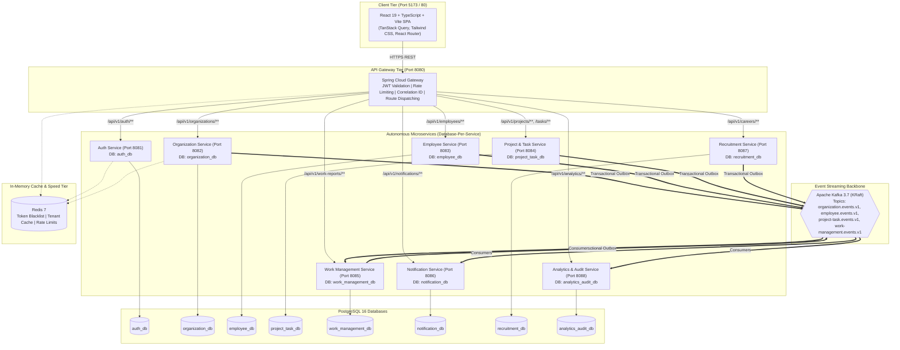

# WorkSphere Engine — Enterprise Multi-Tenant SaaS Platform

> **Full-Stack Architecture Blueprint & Reference Implementation Guide**  
> *React 19 + TypeScript + Vite | Java 21 + Spring Boot 3 Microservices | PostgreSQL 16 | Redis 7 | Apache Kafka (KRaft) | Docker Compose*

---

## 1. Project Vision & Executive Summary

**WorkSphere Engine** is an enterprise-grade, cloud-native, multi-tenant workforce and company management SaaS platform. Multiple independent enterprises operate in cryptographically isolated virtual workspaces with role-based workflows, independent microservice datastores, and event-driven asynchronous processing.

### What WorkSphere Is:
- **True Multi-Tenant SaaS**: Each registered company receives an isolated workspace. Users can belong to multiple companies with independent, organization-scoped roles.
- **Independently Deployable Microservices**: 8 domain services + 1 API Gateway, each owning its PostgreSQL database schema and Flyway migrations.
- **Reliable Event Streaming**: Apache Kafka (KRaft mode) connects cross-service workflows with Transactional Outbox reliability and Dead-Letter Topics (DLT).
- **Modern Unified Frontend**: React 19, TypeScript, Vite, TanStack Query v5, React Hook Form, Zod, and Tailwind CSS with role-aware layouts.

### What WorkSphere Is NOT:
- **NOT a Freelance Marketplace**: Work items are strictly company-internal.
- **NOT a Public Task Marketplace**: Tasks are assigned only to validated organization members.
- **NOT a Single-Company HRMS**: It natively isolates thousands of independent organizations.
- **NOT a Monolith disguised as services**: Real database-per-service boundaries with no cross-database foreign keys or joins.

---

## 2. GitHub Reference Inspection & Comparison

To base WorkSphere on verified engineering patterns, two production repositories were inspected down to source files:
- **Primary Reference**: [WorkSuite HRMS (`tejeswararao8/worksuite`)](https://github.com/tejeswararao8/worksuite)
- **Secondary Reference**: [Multitenant ERP (`jackelKing/Multitenant_ERP`)](https://github.com/jackelKing/Multitenant_ERP)

### Detailed Comparison Matrix

| Architectural Area | WorkSuite (`tejeswararao8`) | Multitenant ERP (`jackelKing`) | WorkSphere Engine Decision |
| :--- | :--- | :--- | :--- |
| **Backend Architecture** | Modular Monolith (Spring Boot 3.2.5, Java 21) | Monolith with Tenant Routing (Spring Boot 3.3.2, Java 21) | **Microservices + Spring Cloud API Gateway** |
| **Frontend Stack** | React 19, CRA (`react-scripts`), React Query v5 | React 19, Vite 8, TypeScript, Oxlint | **React 19 + TypeScript + Vite + TanStack Query v5 + Tailwind CSS** |
| **Multi-Tenancy** | Single DB, column discriminator (`company_id`) | Dynamic Database-per-Tenant (`TenantRoutingDataSource`) | **Logical Database-Per-Service** + strict `organization_id` row-level isolation & signed JWT tenant context |
| **Database Engine** | PostgreSQL (Single shared instance) | MySQL 8.0 | **PostgreSQL 16** with separate logical databases per service |
| **Asynchronous Events**| None (Synchronous in-memory Spring events) | RabbitMQ (Email tasks via `@RabbitListener`) | **Apache Kafka 3.7 (KRaft mode)** with Transactional Outbox, versioned topics & DLT |
| **Caching & Tokens** | Redis for token blacklist & sessions | Redis for session & rate limits (Bucket4j) | **Redis 7**: Tenant-scoped keys (`org:{orgId}:*`), rate limiting, JWT revocation |
| **Storage Strategy** | Database BLOBs / local disk | MinIO S3 object storage | **S3-Compatible Object Storage**: DB holds metadata; files stored via S3 API |
| **Audit & Reporting** | JPA entity auditing | Audit table | **Dedicated Analytics & Audit Service** consuming Kafka domain events |

---

## 3. Technology Stack

```
Frontend:
  - React 19 + TypeScript + Vite 5/6
  - React Router v7 (Nested role-aware route groups)
  - TanStack Query v5 (@tanstack/react-query for server state)
  - React Hook Form + Zod (Type-safe form validations)
  - Tailwind CSS + Lucide Icons + Recharts

Backend:
  - Java 21 LTS + Spring Boot 3.2 / 3.3
  - Spring Cloud Gateway (Reactive, JWT validation, rate limiting)
  - Spring Security 6 + JJWT 0.12.6 (RS256 / HS512)
  - Spring Data JPA + Hibernate 6
  - Flyway Database Migrations (Owned per service)
  - SpringDoc OpenAPI / Swagger

Data & Infrastructure:
  - Database: PostgreSQL 16 (Logical DB per microservice)
  - Event Streaming: Apache Kafka 3.7 in KRaft mode (No Zookeeper)
  - Caching & Coordination: Redis 7 Alpine
  - Local Orchestration: Docker & Docker Compose
```

---

## 4. System Component Topology



---

## 5. Microservices Boundaries & Database Ownership

| Service Name | Port | Database | Responsibilities | Core Entities |
| :--- | :--- | :--- | :--- | :--- |
| **API Gateway** | 8080 | *None* | Routing, JWT validation, header sanitization, rate limiting, request correlation. | Route definitions, filters |
| **Auth Service** | 8081 | `auth_db` | User identity, password encryption, login, JWT issuance, refresh tokens, email verification. | `User`, `UserCredential`, `RefreshToken` |
| **Organization Service** | 8082 | `organization_db`| Company workspaces, settings, invitations, organization-scoped memberships. | `Organization`, `OrganizationMembership`, `Invitation` |
| **Employee Service** | 8083 | `employee_db` | Employee directory, departments, designations, reporting manager hierarchy. | `EmployeeProfile`, `Department`, `Designation` |
| **Project & Task Service**| 8084 | `project_task_db`| Projects, tasks, assignments, status transitions, priorities, task comments. | `Project`, `Task`, `TaskComment`, `OutboxEvent` |
| **Work Management Service**| 8085 | `work_management_db`| Daily/weekly work reports, manager reviews, work requests (`BLOCKER`, `EXTENSION`). | `WorkReport`, `WorkReportReview`, `WorkRequest` |
| **Notification Service** | 8086 | `notification_db`| In-app notification center, user preferences, email delivery coordination. | `Notification`, `NotificationPreference`, `EmailLog` |
| **Recruitment Service** | 8087 | `recruitment_db`| Public job postings, candidate applications, resume metadata, interview scheduling. | `JobPosting`, `CandidateProfile`, `JobApplication` |
| **Analytics & Audit Service**| 8088| `analytics_audit_db`| CQRS event-fed read models, executive productivity metrics, immutable audit trail. | `AuditEntry`, `OrganizationMetricsReadModel` |

---

## 6. Multi-Tenant Security & Identity Propagation

### 6.1. Dual-Identity Model
- **Global User Identity** (`auth_db`): Defines who the user is globally across the platform.
- **Organization Membership** (`organization_db`): Defines the user's role and permissions inside a specific company. A single user can be `COMPANY_OWNER` in Company A and `EMPLOYEE` in Company B.

### 6.2. Identity Propagation Flow
1. **Client Request**: Frontend sends `Authorization: Bearer <JWT>` and `X-Active-Org: <OrgUUID>` to the Gateway.
2. **Gateway Sanitization**: The Gateway strips any incoming client headers (`X-User-Id`, `X-Organization-Id`, `X-User-Roles`) to prevent header spoofing.
3. **Gateway Verification**: Gateway validates JWT signature and verifies that the user's token claims include access to the requested organization.
4. **Trusted Downstream Headers**: Gateway forwards trusted headers to microservices:
   ```http
   X-User-Id: b2c1f8a4-3e91-4d7a-8f5c-0b9e8d7a6c5b
   X-Organization-Id: 9f8e7d6c-5b4a-3e21-0f9e-8d7c6b5a4e32
   X-User-Roles: ROLE_MANAGER,ROLE_EMPLOYEE
   X-Correlation-Id: c9a8b7e6-5d4c-3b2a-1f0e-9d8c7b6a5e4d
   ```
5. **Microservice Isolation**: Downstream services enforce `@PreAuthorize` role checks and strictly append `WHERE organization_id = :callerOrgId` on every database operation.

---

## 7. Apache Kafka Event-Driven Architecture

### 7.1. Candidate Topic Catalogue

| Topic Name | Producing Service | Consuming Services | Key Domain Events |
| :--- | :--- | :--- | :--- |
| `organization.events.v1` | Organization Service | Notification, Analytics/Audit | `organization.created`, `membership.invited`, `membership.activated` |
| `employee.events.v1` | Employee Service | Notification, Analytics/Audit | `employee.created`, `employee.updated`, `employee.terminated` |
| `project-task.events.v1` | Project & Task Service | Notification, Work Management, Analytics | `project.created`, `task.created`, `task.assigned`, `task.status.changed` |
| `work-management.events.v1`| Work Management Service | Notification, Analytics/Audit | `workreport.submitted`, `workreport.reviewed`, `workrequest.created` |
| `recruitment.events.v1` | Recruitment Service | Notification, Analytics/Audit | `application.submitted`, `interview.scheduled` |

### 7.2. Standard Event Envelope
```json
{
  "eventId": "a1b2c3d4-e5f6-7a8b-9c0d-1e2f3a4b5c6d",
  "eventType": "task.assigned",
  "eventVersion": 1,
  "occurredAt": "2026-11-01T10:15:30.123Z",
  "organizationId": "9f8e7d6c-5b4a-3e21-0f9e-8d7c6b5a4e32",
  "aggregateType": "Task",
  "aggregateId": "4e7ec00b-344e-4d52-b13b-c5e6fe5203a7",
  "correlationId": "c9a8b7e6-5d4c-3b2a-1f0e-9d8c7b6a5e4d",
  "producer": "project-task-service",
  "payload": {
    "projectId": "1a2b3c4d-5e6f-7a8b-9c0d-1e2f3a4b5c6d",
    "taskTitle": "Design Database Schema",
    "assigneeEmployeeId": "3b2a1f0e-9d8c-7b6a-5e4d-c9a8b7e65d4c",
    "priority": "HIGH",
    "dueDate": "2026-11-05"
  }
}
```

### 7.3. Transactional Outbox Pattern
To prevent dual-write inconsistencies between PostgreSQL and Kafka:
1. Every domain mutation writes business entity changes and an `outbox_events` record in the **same local database transaction**.
2. A background publisher polls unpublished events using `FOR UPDATE SKIP LOCKED`.
3. The event is published to Kafka with partition key = `aggregateId`.
4. Upon broker ack, `published_at = NOW()` is committed.
5. Consumers maintain idempotency by checking `processed_events` table before applying side effects.

---

## 8. Redis Caching & Coordination Design

| Use Case | Key Pattern | TTL | Strategy & Invalidation |
| :--- | :--- | :--- | :--- |
| **Organization Profile** | `org:{orgId}:profile:v{ver}` | 1 hour | Cache-aside; invalidated on organization update. |
| **Employee Directory** | `org:{orgId}:employee:{id}` | 15 mins | Read-through; caller organization permissions verified before serving. |
| **Dashboard Metrics** | `org:{orgId}:dash:{role}:{period}`| 5 mins | Event-invalidated on major milestone completion. |
| **Rate Limiter** | `rl:{userId}:{route}:{window}` | 1 min | Token bucket algorithm in Spring Cloud Gateway. |
| **JWT Blacklist** | `blacklist:{jti}` | Token expiry | Stored on user logout; rejected immediately by Gateway. |

---

## 9. Docker & Local Orchestration Topology

WorkSphere includes complete container definitions via `docker-compose.yml`:

```
Containers:
  1. postgres:16-alpine (Databases: auth_db, organization_db, employee_db, project_task_db, work_management_db, notification_db, recruitment_db, analytics_audit_db)
  2. redis:7-alpine (Cache & Gateway rate limiter)
  3. kafka:3.7 (Apache Kafka with KRaft mode, port 9092)
  4. api-gateway (Spring Cloud Gateway, port 8080)
  5. auth-service (Port 8081)
  6. organization-service (Port 8082)
  7. employee-service (Port 8083)
  8. project-task-service (Port 8084)
  9. work-management-service (Port 8085)
  10. notification-service (Port 8086)
  11. recruitment-service (Port 8087)
  12. analytics-audit-service (Port 8088)
  13. frontend (React 19 + Nginx, port 5173 / 80)
  14. mailhog (Local SMTP server, Web UI port 8025)
```

---

## 10. Implementation Roadmap & Phase Gates

- **Phase 0: Reference Analysis & Architecture Blueprint** *(Completed)*
- **Phase 1: Foundation & Docker Infrastructure** (Monorepo setup, service skeletons, Gateway routing, PostgreSQL, Redis, Kafka KRaft)
- **Phase 2: Authentication & Token Lifecycle** (Registration, login, JWT rotation, password reset, email verification)
- **Phase 3: Organization & Multi-Tenant Security** (Company onboarding, memberships, invitations, RBAC enforcement)
- **Phase 4: Employee Directory & Hierarchy** (Departments, designations, employee profiles, reporting tree)
- **Phase 5: Projects & Task Management** (Projects, tasks, priority, assignments, comments, history)
- **Phase 6: Work Management** (Daily/weekly reports, manager approvals, blockers, deadline extensions)
- **Phase 7: Kafka Reliability & Outbox** (Outbox dispatchers, idempotent consumers, dead-letter topics)
- **Phase 8: Redis Caching & Rate Limiting** (Tenant cache keys, invalidation triggers, gateway rate limiter)
- **Phase 9: Notifications & Email** (In-app center, SMTP delivery via MailHog, preferences)
- **Phase 10: Recruitment Pipeline** (Public career portal, candidate applications, interview schedules)
- **Phase 11: Analytics & Audit Read-Models** (CQRS read models, executive KPI dashboards, audit trails)
- **Phase 12: Full UI Integration** (Complete role-aware pages, TanStack Query hooks, Zod forms, error boundaries)
- **Phase 13: End-to-End Hardening & Performance** (Tenant isolation tests, k6 load testing, security verification)

---

## 11. Resume Project Summary

```latex
\resumeProjectHeading
  {\textbf{WorkSphere — Multi-Tenant Company Management SaaS Platform} $|$ \emph{React 19, TypeScript, Java 21, Spring Boot, Spring Cloud Gateway, PostgreSQL, Redis, Apache Kafka, Docker}}{2026}
\resumeItemListStart
  \resumeItem{Designed and built an enterprise-grade multi-tenant workforce management SaaS platform enabling independent companies to operate in isolated workspaces with role-based access control (RBAC).}
  \resumeItem{Architected 8 independently deployable Spring Boot 3 microservices with a database-per-service pattern in PostgreSQL 16, Spring Cloud Gateway for JWT validation, and Redis for distributed rate limiting.}
  \resumeItem{Engineered an asynchronous event mesh using Apache Kafka (KRaft mode) with Transactional Outbox pattern, idempotent consumers, and Dead-Letter Topics (DLT) for mission-critical task, employee, and notification workflows.}
  \resumeItem{Implemented an intuitive, role-aware React 19 and TypeScript frontend utilizing TanStack Query v5 for server-state caching, React Hook Form + Zod for form validation, and Tailwind CSS for responsive layouts.}
  \resumeItem{Containerized all microservices, API Gateway, PostgreSQL, Redis, and Kafka using Docker Compose with automated health checks, persistent volumes, and non-root runtime environments.}
\resumeItemListEnd
```
